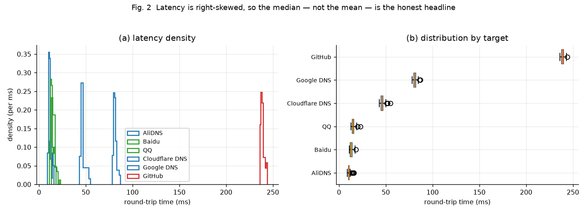
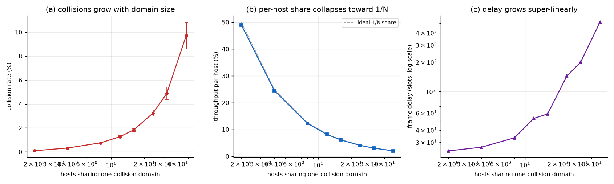
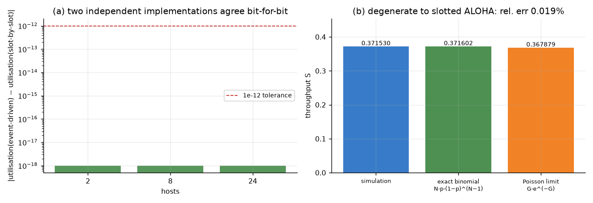

# net-analysis-lab · 网络延迟实测与共享介质建模

**ICMP 采集 → 质量门禁 → 统计推断 → 共享以太网建模**，全程可复现、每个数字都带不确定度。

> *Round-trip latency measured for real, and a shared-medium Ethernet model that can be
> proven correct — where every headline number is regenerated by a script in this repo.*

[](https://github.com/heee-a/net-analysis-lab/actions/workflows/ci.yml)
[](https://www.python.org)
[](tests/)
[](https://heee-a.github.io/net-analysis-lab/)


**[➜ 在线结果页 heee-a.github.io/net-analysis-lab](https://heee-a.github.io/net-analysis-lab/)** — 该页面由 `scripts/build_site.py` 从 `data/` 自动生成，页面里没有一个手写数字。

**目录**：[为什么要有这个仓库](#为什么要有这个仓库) · [实测结果](#实测结果本机跑出来的不是编的) · [仿真](#仿真共享介质为什么会崩) · [凭什么相信](#凭什么相信这些数字) · [已知局限](#已知局限写给自己看也写给读者) · [快速开始](#快速开始)

---

## 为什么要有这个仓库

大多数"网络数据分析"作业止步于画一张折线图。这里想做的是另外三件事：

1. **把不确定度摆在最前面** —— 60 个样本里丢 1 个包，不等于"丢包率 1.667%"，它的 Wilson 95% 区间是 **[0.295%, 8.855%]**。报点估计而不报区间，是这类作业最常见的错误。
2. **质量门禁只打标、不丢行** —— 超时（timeout）保留为显式缺失值。把它们删掉，所有丢包统计都会被系统性拉向 0。
3. **模型必须能自证清白** —— CSMA/CD 仿真写了两版独立实现并做交叉验证；把它退化成时隙 ALOHA 后必须与精确理论值吻合；每个时隙都必须能被记账。

---

## 实测结果（本机跑出来的，不是编的）

2026-10-10 UTC 采集，360 个 ICMP 样本，6 个目标分 3 个层级：

| 目标 | 层级 | 成功/总数 | 丢包率 (%) + Wilson 95% CI | 中位 RTT (ms) + Bootstrap CI | P95 (ms) | RFC3550 抖动 (ms) | 偏度 |
|---|---|---:|---|---:|---:|---:|---:|
| AliDNS | anycast DNS | 59/60 | **1.667** [0.295, 8.855] | **11** [10, 11] | 14.1 | 1.81 | +1.40 |
| Baidu | 国内站点 | 60/60 | 0.000 [0.000, **6.017**] | **13** [12, 13] | 16.1 | 1.71 | +0.80 |
| QQ | 国内站点 | 60/60 | 0.000 [0.000, **6.017**] | **15** [15, 16] | 19.1 | 1.54 | +1.37 |
| Cloudflare DNS | anycast DNS | 33/60 | **45.000** [33.093, 57.508] | **46** [45, 46] | 52.0 | 2.16 | +1.32 |
| Google DNS | anycast DNS | 60/60 | 0.000 [0.000, 6.017] | **81** [80, 81] | 85.0 | 1.60 | +1.24 |
| GitHub | 海外站点 | 60/60 | 0.000 [0.000, 6.017] | **239** [238, 239] | 243.0 | 1.86 | +0.85 |

> "0% 丢包"这个说法骗人。**60 个包全到，只能把丢包率上界压到 6.0%** —— 这是 Wilson 区间告诉我们的，而不是"没问题"。

### 三条从数据里读出来的结论



**① 六个目标全部拒绝正态假设（Shapiro–Wilk, α=0.05），且偏度都为正。**
延迟是右偏的：均值会被少数尖峰拉高，所以本仓库一律用**中位数**做主统计量，Bootstrap 给区间。用"均值 ± 标准差"描述 RTT 是对这类数据的常规误用。

**② 抖动与时延几乎无关。**
中位 RTT 从 11 ms 跨到 239 ms——**21 倍**的差距；而 RFC 3550 抖动只在 **1.54–2.16 ms** 之间——不到 **1.4 倍**。
直觉上"慢的网络更抖"在这批数据里不成立：抖动主要由**本地最后一段链路的排队**决定，而不是端到端距离。这也是为什么用 ping 的抖动去预测 VoIP 质量，往往错得离谱。

**③ anycast 并不保证就近。**
同为 anycast 的三个 DNS 中位时延分别是 11 ms / 46 ms / 81 ms，差 7 倍。anycast 只承诺路由可达最优 POP，不承诺对你所在的接入网最优。

---

## 仿真：共享介质为什么会崩

10 Mb/s 以太网时隙参数：1 时隙 = 512 bit = 51.2 μs，成帧后的数据帧占 **24** 时隙，冲突阻塞占 **1** 时隙。饱和负载，每个配置 8 个独立随机种子 × 200,000 时隙，前 20,000 时隙作预热剔除。

| 主机数 N | 信道利用率 (%) | 碰撞率 (%) | 单主机可得带宽 (%) | 帧时延 (时隙) | 公平性 (Jain) |
|---:|---:|---:|---:|---:|---:|
| 2 | 97.93 ± 0.01 | **0.094** | **48.97** | 24.5 | 0.500 |
| 4 | 97.91 ± 0.01 | 0.319 | 24.48 | 26.7 | 0.278 |
| 8 | 97.87 ± 0.01 | 0.752 | 12.23 | 33.3 | 0.144 |
| 12 | 97.82 ± 0.03 | 1.267 | 8.15 | 52.8 | 0.140 |
| 16 | 97.76 ± 0.02 | 1.834 | 6.11 | 58.6 | 0.120 |
| 24 | 97.61 ± 0.02 | 3.242 | 4.07 | 143.9 | 0.133 |
| 32 | 97.43 ± 0.03 | 4.897 | 3.05 | 199.8 | 0.162 |
| 48 | 96.91 ± 0.04 | **9.722** | **2.02** | 513.1 | 0.262 |

N 从 2 增到 48：

- 碰撞率 **0.094% → 9.722%**（约 **104 倍**）
- 单主机带宽 **48.97% → 2.02%**（逼近 1/N，与理论一致）
- 帧时延 **24.5 → 513.1** 时隙（约 **21 倍**，且加速增长）

**总吞吐几乎不变（≈97% → 96.9%），因为这是一个"永远有数据要发"的饱和模型 —— 精确地说明问题不在"带宽不够"，而在"每个人分到的越来越少、等待越来越久"。**



### 诚实记录：公平性这条曲线是难看的

公平性指数是**非单调**的（0.500 → 0.120 → 0.262），而且绝对值很低。这不是 bug，是 **BEB 的捕获效应（capture effect）**：抢到信道的站把争用窗口复位为 2，而失意的站窗口指数增长，于是赢家更容易再赢。

但必须打两个折扣：

1. 模型假设**每个站永远有数据排队**，这放大了不公平。真实流量的突发性会部分打破捕获。
2. `w_max=1024` 的上限在系统长期运行后才起作用，200k 时隙的窗口可能还没完全显现长期行为。

**所以请把这张表读成"IEEE 802.3 CSMA/CD 在饱和负载下的行为"，而不是"真实局域网的性能预测"。** 这条负结果被保留在这里，理由和本账号其他仓库一样：工程判断比漂亮数字重要。

---

## 凭什么相信这些数字

三条独立防线，**任何一条不成立就应当怀疑整个仓库**：

**① 双实现交叉验证 —— 偏差 0.0e+00**
同一个 CSMA/CD 模型写了两份：事件驱动版（争用时钟 + 堆）和逐时隙版（数组扫描 + busy 计数器）。相同随机种子下结果**逐位一致**。

这道防线在开发过程中真的抓到了 bug：逐时隙版曾在成功分支里让 `t` 前进 `FRAME_SLOTS`、同时保留 `busy = FRAME_SLOTS - 1`，导致每帧实际占用 **47** 个时隙而非 24 —— 信道利用率被整体**压低一半**（0.505 vs 0.9798）。这个错误躲过了所有"看起来合理"的检查，只有交叉验证能抓住。

**② 理论对照 —— 相对误差 0.019%**
把 machinery 退化成无载波侦听、无退避的时隙 ALOHA（N=50, p=0.02, 200 万时隙）：

| | 吞吐 S |
|---|---|
| 仿真 | 0.371530 |
| 精确二项理论 N·p·(1−p)^(N−1) | **0.371602** |
| 泊松极限 G·e^(−G)（教科书常用） | 0.367879 |

注意最后一行的教训：**教科书广泛引用的泊松近似在小 N 下明显偏离**，把它当精确值做对照会把正确的程序判错。

**③ 时隙记账守恒 —— 残差 ~1.2e−04**
空闲 + 成功传输 + 碰撞 = 总时隙。任何一个时隙被漏记或重复记账，残差就会爆掉。



---

## 已知局限（写给自己看，也写给读者）

| 局限 | 影响 | 缓解方式 |
|---|---|---|
| 每目标仅 60 个探针 | 零丢包的上界只能压到 6.0% | Wilson 区间如实暴露宽度；`--count` 可调大 |
| ICMP 常被中间设备限速/降优先级 | "丢包"可能是策略而非拥塞 | 报告为"观测丢包"，不断言成因 |
| 单一主机、单一接入网 | 结论不能外推到别的网络 | 复现命令开放，换机可交叉验证 |
| Windows `ping` 为毫秒分辨率 | 亚毫秒差异不可见 | `time<1ms` 统一记录为 1 ms，质量门禁打标 |
| 饱和负载 + 永久排队 | 放大 BEB 捕获效应、低估公平性 | 已在文中显式打折说明 |

---

## 快速开始

```bash
pip install -r requirements.txt
pytest                                    # 35 个测试
python scripts/run_pipeline.py --count 60 # 采集 + 分析 + 出图
python scripts/run_pipeline.py --reuse    # 不发新包，重算已有样本
python scripts/build_site.py              # 从 data/ 重新生成 Pages 页面
```

采集依赖系统自带 `ping`，**不需要管理员/root 权限**（这也是不用裸套接字的原因）。
解析器语言中立：Windows 中文（`来自 x 的回复: 字节=32 时间=82ms TTL=109`）、Windows 英文、以及 Linux/macOS 输出都能解析；即使编码猜错，`81ms` 与 `TTL=109` 是 ASCII，回退路径依然能救回来 —— 这三种情况都有对应的单元测试。

```
net-analysis-lab/
├── src/netlab/
│   ├── collect.py     ICMP 采集 + 语言中立解析
│   ├── quality.py     质量门禁 / Wilson / Bootstrap / RFC3550 抖动 / Shapiro-Wilk
│   └── sim.py         CSMA/CD 双实现 + 交叉验证 + 理论对照
├── scripts/
│   ├── run_pipeline.py   端到端流水线
│   ├── build_site.py     data/ → 静态站
│   └── publish.py        推送 GitHub + 启用 Pages（需 token）
├── tests/               35 个测试
├── data/raw|processed/   原始样本与派生指标
├── charts/               fig1 – fig5（本地生成物，不入版本库）
└── docs/                 GitHub Pages 站点（自动生成，含 charts/ 副本）
```

---

## 与其他仓库的关系

| 仓库 | 分工 |
|---|---|
| [data-portfolio](https://github.com/heee-a/data-portfolio) | 通用数据采集与分析全链路（9 个项目） |
| **net-analysis-lab**（本仓库） | **网络的一手测量 + 协议层建模，配完整不确定度与自证机制** |
| [dataforge](https://github.com/heee-a/dataforge) | ETL 管道：增量采集 → 星型数仓 → 质量门禁 |
| [ml-bench](https://github.com/heee-a/ml-bench) | 多模型基准 + 显著性检验 + A/B 方法论 |

---

## 许可

MIT © 2026 heee-a
